# Actividad AWS – Documento de evidencias

Luis Miguel García Castaño y Julio José Jaller Cordero – 16/10/2026

# Punto 1 – AWS Secrets Manager

## Evidencia de ejecución

_(Pendiente de ejecución)_

## Respuestas teóricas y de costos

### ¿Qué es?
Servicio administrado para **guardar, recuperar, auditar y rotar secretos**. Cada secreto se cifra en
reposo con AWS KMS (por defecto con la clave administrada `aws/secretsmanager`), tiene **versiones** con
etiquetas (`AWSCURRENT`, `AWSPREVIOUS`, `AWSPENDING`) y cada acceso queda registrado en CloudTrail. Se
integra de forma nativa con RDS, Aurora, Redshift y DocumentDB, que pueden **administrar ellos mismos**
la contraseña maestra dentro de Secrets Manager.

### ¿Qué información permite guardar?
Cualquier texto o binario de hasta **64 KB**, normalmente en JSON clave-valor: credenciales de bases de
datos (usuario, contraseña, host, puerto), claves de API, tokens OAuth, llaves SSH o privadas, cadenas
de conexión y certificados. No es para datos de negocio ni configuración no sensible (para eso está
Parameter Store).

### ¿Cómo se controla quién lo lee?
1. **Políticas de identidad IAM** (usuario o rol): `secretsmanager:GetSecretValue` sobre el ARN exacto del secreto (mínimo privilegio, como en el punto 1).
2. **Política basada en recursos** del propio secreto: permite o niega a principales concretos, incluso de otras cuentas.
3. **Política de la clave KMS**: para descifrar hace falta `kms:Decrypt` (implícito con la clave administrada por AWS; explícito con una clave propia).
4. **Condiciones**: etiquetas (ABAC), `aws:SourceVpce` (solo desde un VPC endpoint), `aws:SourceIp`, MFA.
5. **Auditoría**: CloudTrail registra quién leyó qué secreto y cuándo.

### Crear, recuperar y rotar
| Operación | Qué hace | API |
|---|---|---|
| **Crear** | Registra el secreto y su primera versión (`AWSCURRENT`), cifrada con KMS | `CreateSecret` |
| **Recuperar** | La aplicación, autenticada con IAM, pide el valor en tiempo de ejecución; por defecto recibe `AWSCURRENT` | `GetSecretValue` |
| **Actualizar** | Guarda un valor nuevo y mueve `AWSCURRENT` a esa versión (la anterior pasa a `AWSPREVIOUS`). **No cambia** la contraseña en la base de datos | `PutSecretValue` / `UpdateSecret` |
| **Rotar** | Cambia la credencial **en el sistema destino y en el secreto** de forma coordinada: una función Lambda ejecuta `createSecret → setSecret → testSecret → finishSecret` (o rotación administrada en RDS/Redshift/DocumentDB), con un calendario (p. ej., cada 30 días) | `RotateSecret` |

El punto 1 demuestra que, como el programa siempre pide `AWSCURRENT`, recibe el valor nuevo **sin cambiar el código**.

### Preguntas de costos
- **Secretos almacenados**: 0,40 USD por secreto al mes, prorrateado por hora (un secreto que existe 1 hora cuesta unos 0,00055 USD). Las réplicas en otras regiones cuentan como secretos aparte. Los secretos programados para eliminación no se cobran. Existe una prueba gratuita de 30 días para el primer secreto.
- **Llamadas a la API**: 0,05 USD por cada 10.000 llamadas (`GetSecretValue`, `DescribeSecret`, `PutSecretValue`…).
- **Consultas repetidas**: el costo crece en proporción al número de llamadas. Leer el secreto en cada petición (p. ej., 1 vez por segundo) son unos 2,6 millones de llamadas al mes, es decir **~13 USD/mes**, frente a 0,40 USD del secreto. Además suma latencia (una llamada HTTPS por petición) y puede alcanzar los límites de solicitudes por segundo.
- **Caché en memoria**: conviene cuando el secreto cambia poco y se lee mucho (servidores web, Lambdas reutilizadas, procesos por lotes). Se guarda en la memoria del proceso con un **TTL** (5–60 min) y se vuelve a leer al vencer o si la base de datos rechaza la credencial (rotación). Con TTL de 5 min, la misma aplicación hace ~8.640 llamadas al mes (~0,04 USD). AWS ofrece `aws-secretsmanager-caching` para Python y la *AWS Parameters and Secrets Lambda Extension*. Nunca se guarda en disco ni en registros.

---

# Punto 2 – Despliegue con Terraform, SDK y AWS CLI

## Evidencia de ejecución

## IAM - creación de user_cli (ejecutado con un administrador)  
_2026-10-15 19:09:54_

- Clave AKIA…R5Q7 guardada en el perfil 'user_cli' de AWS CLI (archivo ~/.aws/credentials, fuera del repositorio)

## Respuestas teóricas y de costos

### ¿Qué es Terraform?
Herramienta de **infraestructura como código declarativa** (HCL). Se describe el estado deseado y
Terraform calcula y aplica las diferencias:
- **Proveedores** (`hashicorp/aws`) traducen los recursos a llamadas a la API de AWS.
- **Recursos** (`aws_instance`, `aws_db_instance`…) y **data sources** (VPC por defecto, AMI).
- **Estado** (`terraform.tfstate`): relación entre el código y los recursos reales.
- Flujo: `terraform init` (descarga proveedores) → `validate` → `plan` (muestra qué va a crear, cambiar o destruir) → `apply` (lo ejecuta en el orden del grafo de dependencias) → `destroy` (elimina en orden inverso).

### Autenticación de `user_cli`
Una clave de acceso (Access Key ID + Secret) del usuario IAM se guarda en el perfil `user_cli` de
`~/.aws/credentials` (WSL). AWS CLI, Boto3 y el proveedor de Terraform usan la **misma cadena de
credenciales** (variables de entorno → perfil compartido → SSO → metadatos de instancia) y firman cada
petición con **SigV4**. La autorización la dan las políticas IAM del usuario. Las claves no se guardan en
Secrets Manager porque, para leer un secreto, la herramienta ya tiene que estar autenticada en AWS.

### Estado de Terraform
Guarda **en texto plano** todos los atributos de cada recurso: IDs, ARN, IP, endpoints, configuración y
cualquier valor sensible que reciba (si se escribiera `password = "..."` en `aws_db_instance`, quedaría
en el estado). Con `manage_master_user_password = true` solo se guarda el ARN del secreto. El script
`ejecutar_terraform.py` revisa automáticamente que no haya contraseñas en el estado. El estado no se sube
al repositorio; en equipos se usa un backend remoto cifrado (S3 con bloqueo).

### Comparación de métodos
| | Terraform | Boto3 | AWS CLI |
|---|---|---|---|
| Paradigma | Declarativo | Imperativo (Python) | Imperativo (comandos) |
| Sabe qué creó | Sí (estado) | Solo si lo programo | Solo si lo guardo |
| Vista previa | `plan` | No | No |
| Orden y dependencias | Automáticos | Waiters manuales | `aws ... wait` manuales |
| Repetir sin duplicar | Sí (idempotente) | No, salvo que lo programe | No |
| Borrado | `destroy` | Código en orden inverso | Comandos en orden inverso |
| Uso ideal | Infraestructura reproducible y versionada | Automatización con lógica propia | Tareas puntuales y scripts cortos |

Los tiempos reales quedan en `evidencias/punto2/tiempos.csv`. El tiempo lo domina RDS (5–10 min), igual en los tres métodos.

### Preguntas de costos (sin capa gratuita)
| Componente | 1 hora | 1 semana (168 h) |
|---|---|---|
| EC2 t3.micro (0,0104 USD/h) | 0,0104 | 1,75 |
| EBS gp3 8 GB (0,08 USD/GB-mes) | 0,0009 | 0,15 |
| RDS PostgreSQL db.t4g.micro Single-AZ (0,016 USD/h) | 0,0160 | 2,69 |
| Almacenamiento RDS gp3 20 GB (0,115 USD/GB-mes) | 0,0032 | 0,53 |
| Secreto de RDS (0,40 USD/mes) | 0,0005 | 0,09 |
| Bucket S3 vacío | 0 | 0 |
| **Total** | **≈ 0,031 USD** | **≈ 5,2 USD** |

- **Cargos sin tráfico**: la EC2 encendida (horas), su disco EBS (incluso apagada), la instancia RDS (horas), el almacenamiento de RDS, el secreto, una IPv4 pública si se asigna (0,005 USD/h, aquí evitada) y los snapshots que se conserven. Un bucket vacío no cuesta.
- **Secreto de RDS**: 0,40 USD/mes prorrateado (≈ 0,09 USD por semana) más 0,05 USD por cada 10.000 llamadas. La rotación administrada por RDS no tiene costo adicional.
- Con la capa gratuita (cuentas elegibles): 750 h/mes de t3.micro y de db.t4g.micro y 20 GB de RDS, lo que puede dejar el costo en ~0.

---

# Punto 3 – Amazon DocumentDB

## Evidencia de ejecución

_(Pendiente de ejecución)_

## Respuestas teóricas y de costos

### DocumentDB frente a MongoDB: diferencias que afectan una aplicación existente
1. **No es MongoDB**: es un motor propio de AWS que implementa la API y el protocolo de MongoDB (compatibilidad 3.6, 4.0 y 5.0). Algunos operadores, etapas de agregación y comandos no están soportados o se comportan distinto (p. ej., `mapReduce`, `$where`, funciones JavaScript, algunas opciones de `$lookup`, colaciones). Hay que revisar la aplicación con la herramienta de compatibilidad.
2. **Retryable writes no soportadas**: los drivers modernos las activan por defecto, así que hay que usar `retryWrites=false` o fallarán las escrituras.
3. **Red y seguridad**: solo es accesible dentro de una VPC (sin endpoint público), con TLS activado por defecto y el certificado de AWS (`global-bundle.pem`). Desde fuera hace falta un túnel, una VPN, etc.
4. **Arquitectura y escalado**: el almacenamiento es compartido y se replica 6 veces en 3 zonas de disponibilidad; las réplicas de lectura (hasta 15) leen del mismo volumen. No hay *sharding* en clústeres basados en instancias (sí en Elastic Clusters). La consistencia de lectura en réplicas es eventual.
5. **Otros**: change streams deben habilitarse por colección; los límites de transacciones son distintos; no existen funciones exclusivas de Atlas (Atlas Search, Triggers, etc.); la autenticación usa SCRAM-SHA-1.

### Aprovisionado frente a Serverless (us-east-1)
| | Serverless (mín. 0,5 DCU) | db.t3.medium aprovisionado |
|---|---|---|
| Cómputo | 0,0822 USD/DCU-h → **0,041 USD/h** al mínimo | ≈ 0,078 USD/h |
| 3 h de práctica | ≈ 0,12 USD | ≈ 0,23 USD |
| Escala | Automática entre 0,5 y el máximo (se limitó a 1 DCU) | Fija |
| Capa gratuita | No | 750 h de db.t3.medium durante 1 mes (prueba de DocumentDB) |

**Elección**: Serverless con 0,5–1 DCU es la opción más barata en us-east-1 para unas horas de uso. Nunca
baja a 0, pero al mínimo cuesta cerca de la mitad que la t3.medium. Si la cuenta aún tiene la prueba
gratuita de DocumentDB, `--provisionado` con db.t3.medium sale en 0 USD.
Almacenamiento: 0,10 USD/GB-mes; I/O: 0,20 USD por millón (Standard). Ambos son despreciables en la práctica.

### ¿Cuánto agrega la EC2 del túnel?
t3.micro 0,0104 USD/h + IPv4 pública 0,005 USD/h + EBS 8 GB ≈ 0,0009 USD/h = **≈ 0,016 USD/h**
(≈ 2,7 USD por semana). Es menos que el propio DocumentDB, pero en Serverless representa cerca del 40 %
adicional. La capa gratuita de EC2 puede cubrir la instancia (no la IPv4 pública).

---

# Punto 4 – Amazon Neptune

## Evidencia de ejecución

## Paso 1 - Red, seguridad y clúster Neptune con endpoint público  
_2026-10-15 20:53:11_

## Paso 1 - Red, seguridad y clúster Neptune con endpoint público  
_2026-10-15 20:55:34_

## Paso 1 - Red, seguridad y clúster Neptune con endpoint público  
_2026-10-15 20:58:38_

## Paso 1 - Red, seguridad y clúster Neptune con endpoint público  
_2026-10-15 21:01:02_

- Versión del motor: 1.4.8.1 (públicos desde 1.4.6) | clase: db.t4g.medium
- VPC por defecto vpc-07bf2d2d4397b6f43: ruta 0.0.0.0/0 -> ['igw-0e479c981895c5f90'] (subredes públicas)
- Grupo de seguridad sg-06b963e2ace085e8c: TCP 8182 solo desde 190.240.81.246/32
- Endpoint del clúster: taller-ingdata-neptune.cluster-cyjau6o6m52z.us-east-1.neptune.amazonaws.com:8182 | IAM auth=True | PubliclyAccessible=True

## Prueba de conexión desde el computador local (HTTPS + SigV4)  
_2026-10-15 21:12:54_

- Estado: healthy | versión 1.4.8.1.R1 | IAMAuthentication: enabled

## Paso 2 - Carga del grafo (openCypher)  
_2026-10-15 21:13:11_

- 6 vértices :Estudiante
- 2 vértices :Profesor
- 4 vértices :Curso
- 2 vértices :Ciudad
- 7 aristas :CONOCE
- 11 aristas :INSCRITO_EN
- 4 aristas :DICTA
- 3 aristas :REQUIERE
- 8 aristas :VIVE_EN

**conteo_vertices** 

| etiqueta | total |
|---|---|
| Ciudad | 2 |
| Curso | 4 |
| Estudiante | 6 |
| Profesor | 2 |

**conteo_aristas** 

| tipo | total |
|---|---|
| CONOCE | 7 |
| DICTA | 4 |
| INSCRITO_EN | 11 |
| REQUIERE | 3 |
| VIVE_EN | 8 |

- Total: 14 vértices y 33 relaciones

## Paso 3 - Consultas que recorren relaciones (Python + openCypher y Gremlin)  
_2026-10-15 21:16:34_

- **q1_recomendar_amigos** - ¿A quién podría conocer Ana? Amigos de sus amigos que aún no conoce (2 saltos por CONOCE).

**q1_recomendar_amigos** - ¿A quién podría conocer Ana? Amigos de sus amigos que aún no conoce (2 saltos por CONOCE). (17639 ms)

| sugerido | amigos_en_comun | num_amigos_comun |
|---|---|---|
| Diego | Carla -> Bruno | 2 |
| Elena | Carla | 1 |

- **q2_profesores_de_medellin** - ¿Qué profesores dictan cursos a estudiantes que viven en Medellín, en qué cursos y a quiénes? (3 saltos: Ciudad<-VIVE_EN-Estudiante-INSCRITO_EN->Curso<-DICTA-Profesor)

**q2_profesores_de_medellin** - ¿Qué profesores dictan cursos a estudiantes que viven en Medellín, en qué cursos y a quiénes? (3 saltos: Ciudad<-VIVE_EN-Estudiante-INSCRITO_EN->Curso<-DICTA-Profesor) (17319 ms)

| profesor | curso | estudiantes | nota_promedio |
|---|---|---|---|
| Prof. Gómez | Bases de Datos | Carla | 4.7 |
| Prof. Gómez | Ingeniería de Datos | Diego -> Ana | 4.0 |
| Prof. Rojas | Computación en la Nube | Carla -> Ana | 4.05 |
| Prof. Rojas | Visión Artificial | Diego | 4.4 |

- **q3_ruta_prerrequisitos** - ¿Qué cursos hay que aprobar antes de Visión Artificial? (camino de longitud variable por REQUIERE)

**q3_ruta_prerrequisitos** - ¿Qué cursos hay que aprobar antes de Visión Artificial? (camino de longitud variable por REQUIERE) (17312 ms)

| prerrequisito | nivel |
|---|---|
| Ingeniería de Datos | 1 |
| Bases de Datos | 2 |

- **q4_cadena_contactos** - ¿Por qué cadena de conocidos llega Ana hasta Felipe? (caminos de hasta 4 saltos por CONOCE)

**q4_cadena_contactos** - ¿Por qué cadena de conocidos llega Ana hasta Felipe? (caminos de hasta 4 saltos por CONOCE) (17125 ms)

| nodos | saltos |
|---|---|
| Ana -> Carla -> Diego -> Felipe | 3 |
| Ana -> Bruno -> Diego -> Felipe | 3 |
| Ana -> Carla -> Elena -> Felipe | 3 |

**g1_recomendar_amigos** - Igual que q1 en Gremlin: amigos de amigos de Ana que no son sus amigos.

| resultado |
|---|
| "Diego" |
| "Elena" |

**g2_profesores_de_medellin** - Igual que q2 en Gremlin: profesores de los estudiantes que viven en Medellín.

| resultado |
|---|
| "Prof. Gómez" |
| "Prof. Rojas" |

**g3_ruta_prerrequisitos** - Igual que q3 en Gremlin: caminos de prerrequisitos desde Visión Artificial.

| resultado |
|---|
| {"labels": [[], []], "objects": ["Visión Artificial", "Ingeniería de Datos"]} |
| {"labels": [[], [], []], "objects": ["Visión Artificial", "Ingeniería de Datos", "Bases de Datos"]} |

## Paso 4 - Costos  
_2026-10-15 21:18:02_

**estimacion_costos** 

| componente | uso | costo_usd |
|---|---|---|
| Instancia db.t4g.medium (aprovisionada) | 0.098 USD/h (ref.) | 1 h: $0.098 | semana: $16.46 | uso real ~0.28 h: $0.027 |
| Serverless mínimo 1 NCU (comparación) | 0.1608 USD/NCU-h | 1 h: $0.161 | semana: $27.01 |
| Almacenamiento | 0.0000 GB usados (VolumeBytesUsed) | $0.0000/mes |
| I/O | pocas miles de peticiones | 0.2 USD/millón -> ~$0.00 |
| Endpoint público | sin EC2 ni túnel | $0.00 adicional (solo transferencia de datos) |
| Capa gratuita (cuentas nuevas) | 750 h t3/t4g.medium por 30 días | posible $0 |

## Limpieza - eliminación y verificación  
_2026-10-15 21:42:18_

- Solicitada eliminación de la instancia
- Solicitada eliminación del clúster (sin snapshot final)

**verificacion_eliminacion** 

| recurso | estado |
|---|---|
| Instancia | no existe (DBInstanceNotFound) |
| Clúster | no existe (DBClusterNotFoundFault) |
| Snapshots del clúster | ninguno |
| DB subnet group | no existe (DBSubnetGroupNotFoundFault) |
| Security group | no existe (InvalidGroup.NotFound) |

## Capturas de pantalla

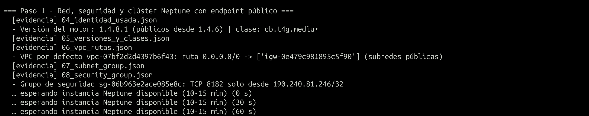
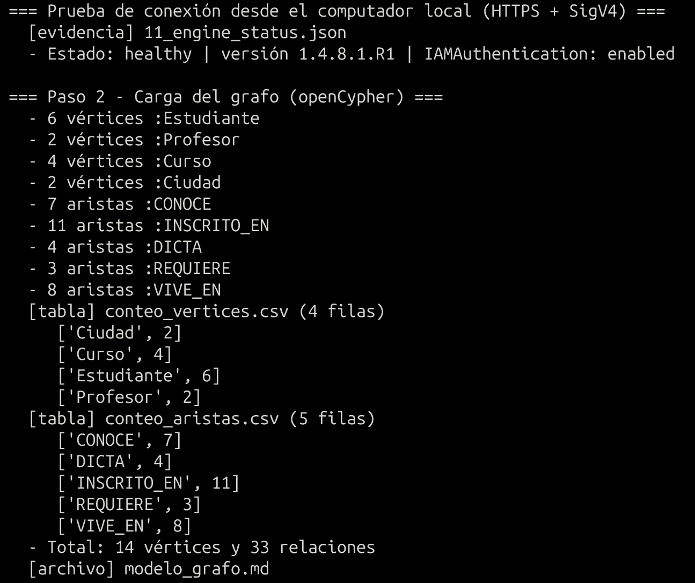
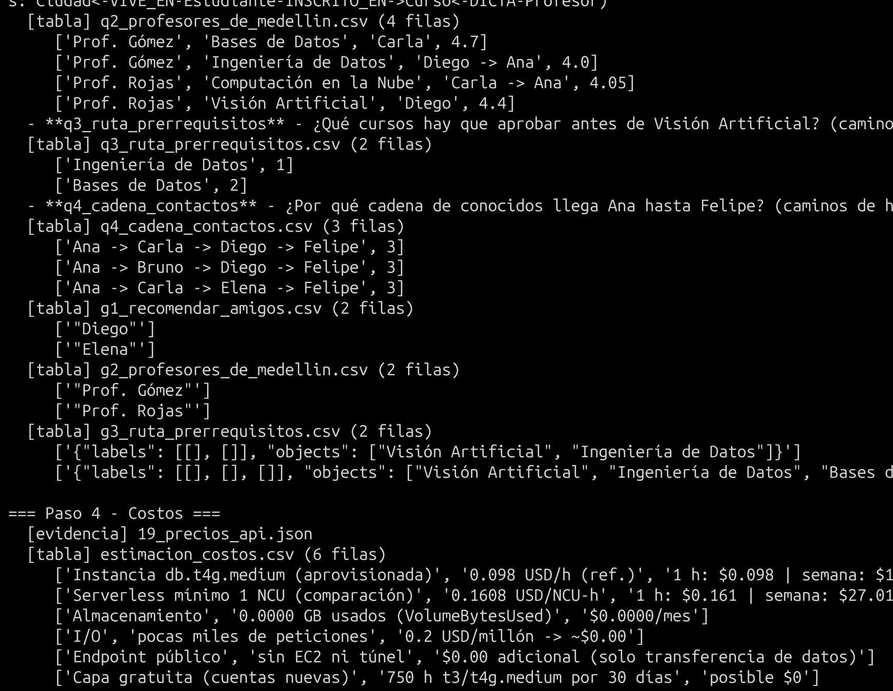
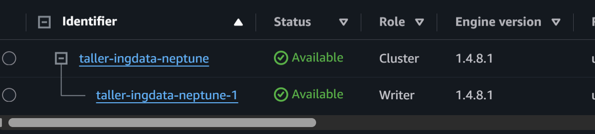

## Respuestas teóricas y de costos

### Neptune frente a Neo4j
| | Amazon Neptune | Neo4j |
|---|---|---|
| Modelos de datos | **Grafo de propiedades** (LPG) **y RDF** (W3C) en el mismo servicio | Grafo de propiedades etiquetado (RDF solo con el plugin *neosemantics*) |
| Lenguajes | **Gremlin** (Apache TinkerPop), **openCypher** y **SPARQL 1.1** | **Cypher** completo (+ procedimientos APOC); GQL |
| Herramientas | Graph Notebook / Neptune Workbench (Jupyter), Graph Explorer, API `neptunedata`, cargador masivo desde S3, Neptune Streams, CloudWatch, Neptune Analytics para algoritmos | Neo4j Browser, Bloom, Desktop, cypher-shell, `neo4j-admin import`, Graph Data Science (algoritmos), AuraDB (administrado) |
| Operación | Totalmente administrado en AWS: VPC, IAM, almacenamiento autoescalable hasta 128 TiB, hasta 15 réplicas | Autogestionado (Community/Enterprise) o AuraDB en la nube |
| Autenticación | IAM (SigV4) opcional, obligatoria con endpoint público | Usuario y contraseña, roles |

En este taller se usó openCypher (muy parecido al Cypher de Neo4j) y las mismas consultas en Gremlin.

### Aprovisionado frente a Serverless
Neptune Serverless cobra 0,1608 USD por NCU-hora con un **mínimo de 1 NCU** (≈ 0,16 USD/h) y no baja a 0.
Una instancia **db.t4g.medium / db.t3.medium** cuesta menos por hora (≈ 0,08–0,10 USD/h; el valor exacto
queda en `precios_api.json`) y está en la capa gratuita de Neptune (750 h durante 30 días para cuentas
nuevas en Neptune). Para un taller corto y con poca carga, la **aprovisionada pequeña es más barata**.

### Acceso desde local
- **Endpoint público** (elegido; Neptune ≥ 1.4.6, septiembre de 2025): la instancia se crea con `PubliclyAccessible=true` en subredes públicas (ruta `0.0.0.0/0` → Internet Gateway); el grupo de seguridad abre solo TCP 8182 a la IP del estudiante (/32), y la **autenticación IAM es obligatoria** (SigV4, la hace `boto3.client("neptunedata")`). No requiere EC2.
- **Túnel SSH con EC2**: bastión en subred pública + `ssh -L 8182:<endpoint>:8182`. Funciona con cualquier versión, pero añade una EC2 (≈ 0,016 USD/h con IPv4) y la gestión de llaves y del puerto 22. Con IAM auth, la firma SigV4 debe incluir el host real, no `localhost`.
- **¿Es necesario el proceso con EC2?** Ya no, si la versión es 1.4.6 o superior. **Otras maneras**: SSM Session Manager con *port forwarding* (sin abrir el puerto 22, pero sigue necesitando una instancia administrada), Neptune Workbench / Graph Notebook dentro de la VPC, AWS Client VPN o Site-to-Site VPN, y una Lambda o API Gateway dentro de la VPC que exponga las consultas.

### Preguntas de costos
- **Cómputo**: por instancia-hora (facturado por segundo) en aprovisionado; por NCU-hora en Serverless.
- **Almacenamiento**: 0,10 USD/GB-mes según lo usado (el grafo del taller ocupa unos MB); **I/O**: 0,20 USD por millón de peticiones; backups gratis hasta el 100 % del almacenamiento del clúster.
- **¿Añade EC2 el método de conexión?** No: el endpoint público no tiene costo propio; solo la transferencia de datos y, como cualquier IPv4 pública en AWS, ≈ 0,005 USD/h por la dirección pública de la instancia.
- **Sin consultas se sigue cobrando**: las horas de la instancia (o el mínimo de 1 NCU en Serverless), el almacenamiento del volumen, los snapshots manuales y la IPv4 pública. Neptune aprovisionado no se puede pausar indefinidamente (se puede detener hasta 7 días); por eso se elimina al terminar.

---

# Punto 5 – Amazon Redshift

## Evidencia de ejecución

## Paso 1 - Despliegue de Redshift Serverless  
_2026-10-15 20:04:28_

- Bucket privado: s3://taller-ingdata-p5-129898048658-us-east-1
- Secreto del administrador (administrado por Redshift): arn:aws:secretsmanager:us-east-1:129898048658:secret:redshift!taller-ingdata-ns-admin_taller-FPwVYy
- Workgroup taller-ingdata-wg: capacidad base 4 RPU, acceso público=False, endpoint=taller-ingdata-wg.129898048658.us-east-1.redshift-serverless.amazonaws.com
- Límite de uso: 4 RPU-hora/día (alerta en log) como control de costos

## Paso 2 - Subida a S3, creación de tablas y COPY  
_2026-10-15 20:08:28_

- CSV subidos a s3://taller-ingdata-p5-129898048658-us-east-1/redshift/datos/

**conteo_filas_cargadas** - Filas cargadas por COPY (esperado: 20, 10, 120)

| tabla | filas |
|---|---|
| clientes | 20 |
| pedidos | 120 |
| productos | 10 |

**historial_copy** - Historial de cargas COPY

| query_id | table_name | file_format | loaded_rows | loaded_bytes | duration | status |
|---|---|---|---|---|---|---|
| 1610 | pedidos | Text | 120 | 3186 | 459355 | completed |
| 1597 | productos | Text | 10 | 373 | 331816 | completed |
| 1588 | clientes | Text | 20 | 1008 | 505703 | completed |

## Inspección de componentes (tablas, distribución, ordenamiento)  
_2026-10-15 20:11:01_

**svv_table_info** - Estilo de distribución y llave de ordenamiento de cada tabla

| tabla | diststyle | sortkey1 | tbl_rows | bloques_1mb |
|---|---|---|---|---|
| clientes | ALL | AUTO(SORTKEY) | 20 | 16 |
| pedidos | KEY(id_cliente) | fecha_pedido | 120 | 288 |
| productos | ALL | AUTO(SORTKEY) | 10 | 14 |

## Paso 3 - Consultas (filtro, unión, agregación)  
_2026-10-15 20:11:36_

- **q1_filtro** - ¿Qué pedidos del tercer trimestre de 2026 (jul-sep) fueron de 3 o más unidades?

**q1_filtro** - ¿Qué pedidos del tercer trimestre de 2026 (jul-sep) fueron de 3 o más unidades?

| id_pedido | fecha_pedido | id_cliente | id_producto | cantidad | descuento_pct |
|---|---|---|---|---|---|
| 1059 | 2026-07-16 | 19 | 5 | 5 | 0 |
| 1104 | 2026-07-16 | 11 | 8 | 3 | 5 |
| 1079 | 2026-07-18 | 6 | 6 | 3 | 10 |
| 1006 | 2026-07-25 | 16 | 3 | 5 | 15 |
| 1019 | 2026-07-25 | 15 | 6 | 4 | 5 |
| 1047 | 2026-07-28 | 12 | 7 | 5 | 0 |
| 1092 | 2026-07-28 | 12 | 4 | 3 | 0 |
| 1068 | 2026-08-03 | 14 | 1 | 5 | 10 |
| 1087 | 2026-08-11 | 15 | 4 | 3 | 15 |
| 1071 | 2026-08-15 | 19 | 4 | 3 | 15 |
| 1073 | 2026-08-16 | 6 | 9 | 3 | 15 |
| 1004 | 2026-08-21 | 15 | 1 | 3 | 0 |
| 1020 | 2026-08-25 | 19 | 10 | 3 | 0 |
| 1120 | 2026-09-05 | 20 | 2 | 3 | 10 |
| 1078 | 2026-09-09 | 16 | 1 | 3 | 15 |
| 1024 | 2026-09-13 | 15 | 9 | 4 | 0 |
| 1100 | 2026-09-21 | 18 | 8 | 4 | 15 |
| 1035 | 2026-09-23 | 4 | 10 | 3 | 0 |
| 1064 | 2026-09-29 | 18 | 6 | 5 | 0 |

- ¿Coincide con la verificación local en SQLite? sí
- **q2_union** - ¿Cuáles son los 10 pedidos de mayor valor neto hechos por clientes de Medellín, con el nombre del cliente y del producto?

**q2_union** - ¿Cuáles son los 10 pedidos de mayor valor neto hechos por clientes de Medellín, con el nombre del cliente y del producto?

| id_pedido | fecha_pedido | cliente | producto | cantidad | descuento_pct | valor_neto |
|---|---|---|---|---|---|---|
| 1078 | 2026-09-09 | Pablo Vargas | Portatil 14 | 3 | 15 | 8922450 |
| 1105 | 2026-04-04 | Diego Restrepo | Portatil 14 | 3 | 15 | 8922450 |
| 1062 | 2026-04-15 | Pablo Vargas | Portatil 14 | 2 | 0 | 6998000 |
| 1006 | 2026-07-25 | Pablo Vargas | Monitor 27 | 5 | 15 | 5482500 |
| 1007 | 2026-04-17 | Diego Restrepo | Escritorio en L | 4 | 0 | 4600000 |
| 1041 | 2026-04-17 | Isabel Vargas | Escritorio en L | 4 | 0 | 4600000 |
| 1095 | 2026-06-21 | Isabel Vargas | Escritorio en L | 3 | 5 | 3277500 |
| 1058 | 2026-05-29 | Pablo Vargas | Portatil 14 | 1 | 10 | 3149100 |
| 1107 | 2026-08-10 | Carla Lopez | Escritorio en L | 2 | 0 | 2300000 |
| 1085 | 2026-07-07 | Diego Restrepo | Escritorio en L | 2 | 15 | 1955000 |

- ¿Coincide con la verificación local en SQLite? sí
- **q3_agregacion** - ¿Cuánto se vendió (neto) por categoría de producto y segmento de cliente, y cuál fue el ticket promedio?

**q3_agregacion** - ¿Cuánto se vendió (neto) por categoría de producto y segmento de cliente, y cuál fue el ticket promedio?

| categoria | segmento | num_pedidos | unidades | ventas_netas | ticket_promedio |
|---|---|---|---|---|---|
| Tecnologia | Corporativo | 39 | 79 | 90797450 | 2328140 |
| Tecnologia | Estandar | 16 | 37 | 50174300 | 3135894 |
| Muebles | Corporativo | 20 | 43 | 38361600 | 1918080 |
| Muebles | Premium | 6 | 14 | 15516550 | 2586092 |
| Muebles | Estandar | 11 | 15 | 14162100 | 1287464 |
| Tecnologia | Premium | 9 | 14 | 7018300 | 779811 |
| Hogar | Corporativo | 9 | 24 | 5367300 | 596367 |
| Hogar | Estandar | 6 | 14 | 3067950 | 511325 |
| Hogar | Premium | 4 | 7 | 1812000 | 453000 |

- ¿Coincide con la verificación local en SQLite? sí
- **q4_top_clientes** - ¿Qué 5 clientes generaron más ventas netas y cuántos pedidos hicieron? (filtro + unión + agregación + HAVING)

**q4_top_clientes** - ¿Qué 5 clientes generaron más ventas netas y cuántos pedidos hicieron? (filtro + unión + agregación + HAVING)

| id_cliente | nombre | ciudad | segmento | num_pedidos | ventas_netas |
|---|---|---|---|---|---|
| 16 | Pablo Vargas | Medellin | Corporativo | 7 | 26361050 |
| 4 | Diego Restrepo | Medellin | Corporativo | 10 | 22722450 |
| 15 | Olga Gomez | Envigado | Estandar | 10 | 21965150 |
| 10 | Julian Mejia | Bogota | Corporativo | 7 | 19569500 |
| 14 | Nicolas Gomez | Barranquilla | Estandar | 6 | 18501050 |

- ¿Coincide con la verificación local en SQLite? sí

## Paso 4 - Uso y costos  
_2026-10-15 20:13:55_

**uso_serverless** - Consumo registrado por Redshift Serverless

| rpu_segundos_cobrados | rpu_segundos_computo | rpu_max | almacenamiento_mb |
|---|---|---|---|
| 1200 | 58.0 | 4.0 | 426 |

**estimacion_costos** - Precio de referencia 0.375 USD/RPU-h (us-east-1), mínimo 60 s por cobro

| componente | uso | costo_usd |
|---|---|---|
| Cómputo consumido en el taller | 1200 RPU-s | $0.1250 |
| Cómputo 1 hora activa (4 RPU) | 4 RPU-h | $1.50 |
| Cómputo inactivo | 0 RPU | $0.00 (Serverless no cobra sin consultas) |
| Almacenamiento administrado (RMS) | 426 MB | $0.0100/mes |
| Secreto del admin (Secrets Manager) | 1 secreto | $0.40/mes prorrateado (~$0.0005/h) |
| S3 (3 CSV, < 10 KB) | - | < $0.0001/mes |
| Provisionado ra3.large 1 nodo (referencia) | ~$0.54/h | se cobra encendido 24/7 |

## Limpieza - eliminación de recursos y verificación  
_2026-10-15 20:46:35_

- Solicitada la eliminación del workgroup
- Solicitada la eliminación del namespace (sin snapshot final)

**verificacion_eliminacion** 

| recurso | estado |
|---|---|
| Workgroup | no existe (ResourceNotFoundException) |
| Namespace | no existe (ResourceNotFoundException) |
| Secreto admin | no existe (ResourceNotFoundException) |
| Snapshots manuales del namespace | ninguno |
| Rol IAM | no existe |
| Bucket S3 | no existe |

## Capturas de pantalla

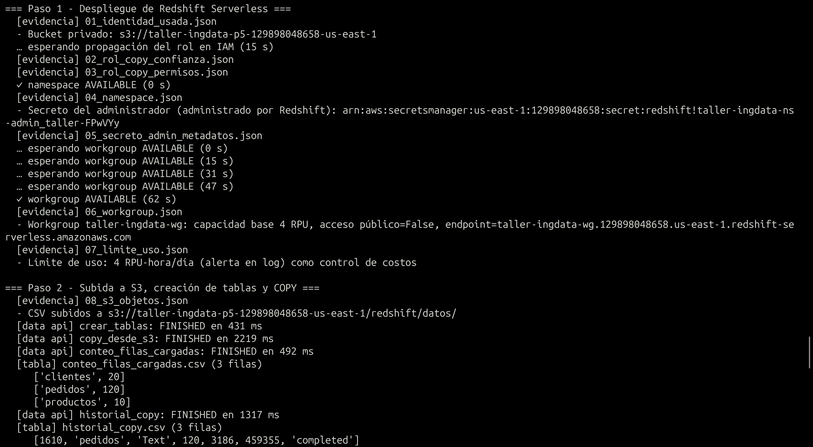
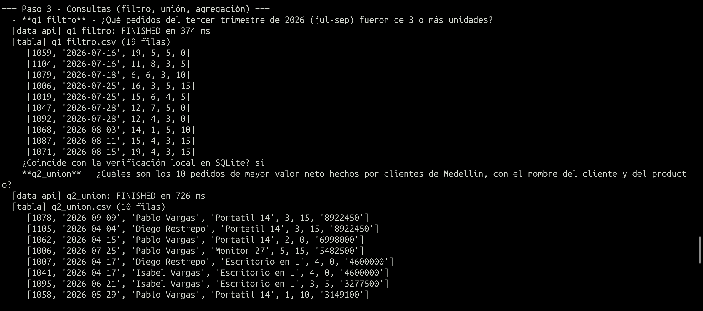
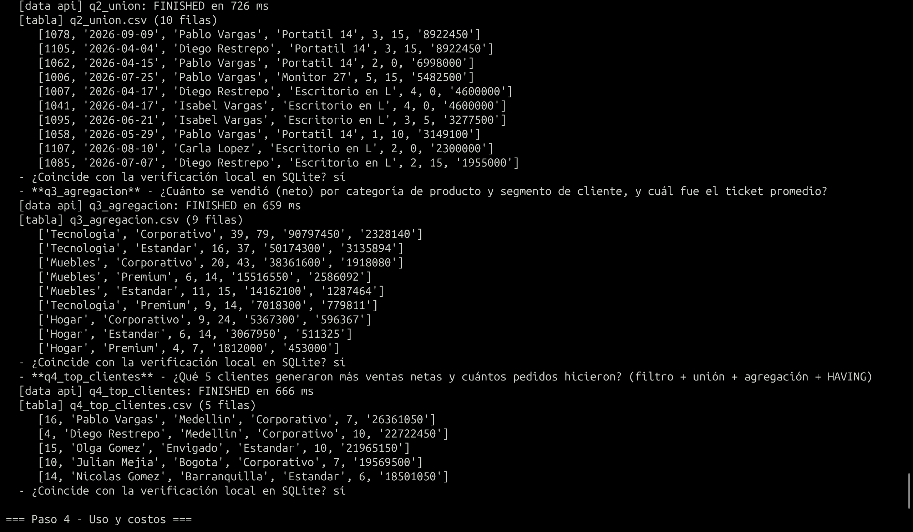
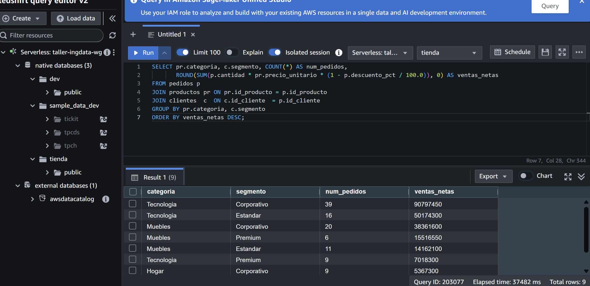

## Respuestas teóricas y de costos

### ¿Qué es y para qué sirve?
Almacén de datos (*data warehouse*) **columnar y MPP** (procesamiento masivamente paralelo) para
**análisis OLAP**: consultas que recorren millones o miles de millones de filas con agregaciones, uniones
entre tablas de hechos y dimensiones, reportes de BI, tableros e históricos de varios años, consultas
sobre el data lake en S3 (Redshift Spectrum) y ML con SQL.

### Componentes principales
- **Provisionado**: *clúster* con **nodo líder** (recibe el SQL, planifica y combina resultados) y **nodos de cómputo** divididos en *slices* que procesan en paralelo; con nodos RA3 los datos viven en **Redshift Managed Storage** (RMS, en S3) con caché local.
- **Serverless**: **namespace** (bases de datos, esquemas, tablas, usuarios, almacenamiento y el secreto del administrador) + **workgroup** (cómputo en RPU, red, subredes, grupos de seguridad y endpoint).
- **Diseño físico**: almacenamiento columnar comprimido, **estilos de distribución** (`AUTO`, `EVEN`, `KEY`, `ALL`) y **llaves de ordenamiento** (*sort keys*) para leer menos bloques.
- **Carga y acceso**: `COPY` desde S3 en paralelo (con un rol IAM), `UNLOAD`, API de datos, Query Editor v2, drivers JDBC/ODBC, snapshots y *concurrency scaling*.

### Redshift frente a RDS
| | Amazon RDS | Amazon Redshift |
|---|---|---|
| Carga de trabajo | **OLTP**: muchas transacciones pequeñas (insertar o actualizar un pedido, consultar por ID) | **OLAP**: pocas consultas grandes que agregan millones de filas |
| Almacenamiento | Por filas | Por columnas, comprimido, MPP |
| Integridad | PK, FK y UNIQUE se hacen cumplir | PK y FK son informativas (no se validan) |
| Escala | Vertical + réplicas de lectura | Horizontal (nodos/RPU), petabytes |

**Casos**: **RDS** para la base transaccional de la tienda en línea (registrar pedidos, pagos e inventario en tiempo real). **Redshift** para analizar 3 años de ventas uniendo pedidos, clientes y marketing (ventas por región, mes y segmento).

### Elección para el taller
**Serverless con 4 RPU de base** en us-east-1 (ver `punto5_redshift/README.md`): solo cobra mientras hay
consultas, sin nodos encendidos 24/7. Con unas decenas de consultas cortas el consumo es de minutos de
RPU (céntimos de dólar); además, las cuentas nuevas pueden tener 300 USD de crédito de prueba.

### Interpretación de las consultas (resultados esperados, verificados en SQLite)
- **q1 – Filtro**: *¿Qué pedidos del tercer trimestre (julio–septiembre de 2026) fueron de 3 o más unidades?* → 19 de los 61 pedidos del trimestre (≈ 31 %) son compras de volumen. Se reparten entre julio (7), agosto (6) y septiembre (6). 8 de ellos se dieron sin descuento, es decir, el volumen no depende del descuento.
- **q2 – Unión (3 tablas)**: *¿Cuáles son los 10 pedidos de mayor valor neto de clientes de Medellín?* → Los encabezan el **Portátil 14** (dos pedidos de 3 unidades con 15 % de descuento, 8.922.450 c/u) y el **Escritorio en L**. **Pablo Vargas** aparece 4 veces y **Diego Restrepo** 3 veces en el top 10: unos pocos clientes corporativos concentran los pedidos grandes de la ciudad.
- **q3 – Agregación**: *¿Cuánto se vendió (neto) por categoría y segmento?* → Ventas netas totales ≈ 226,3 millones. **Tecnología–Corporativo** lidera con 90,8 M (40 % del total, 39 pedidos), seguido de Tecnología–Estándar (50,2 M) y Muebles–Corporativo (38,4 M). **Hogar** es la categoría más pequeña en todos los segmentos. El segmento **Premium** compra poca tecnología (7,0 M), una posible oportunidad comercial. El ticket promedio más alto es Tecnología–Estándar (≈ 3,14 M).
- **q4 – Combinada (unión + agregación + HAVING)**: *¿Qué 5 clientes con al menos 5 pedidos generaron más ventas?* → Pablo Vargas (Medellín, Corporativo, 26,4 M en 7 pedidos), Diego Restrepo (Medellín, Corporativo, 22,7 M en 10), Olga Gómez (Envigado, 22,0 M), Julián Mejía (Bogotá, 19,6 M) y Nicolás Gómez (Barranquilla, 18,5 M). El top 5 suma ≈ 109 M, cerca del 48 % de las ventas: alta concentración en pocos clientes.

El script compara automáticamente los resultados de Redshift con estos (columna "¿Coincide…?" del log).

### Preguntas de costos
- **Modalidad más barata para esta práctica**: Serverless. Provisionado (p. ej., ra3.large ≈ 0,54 USD/h, verificar en `precios_api.json`) cobra cada hora que el clúster existe, haya o no consultas.
- **Cómputo**: Serverless cobra **RPU-hora** (0,375 USD/RPU-h en us-east-1) por segundo, con mínimo de 60 s, solo mientras procesa; 4 RPU activos durante una hora = 1,50 USD. Provisionado cobra por **nodo-hora**. La API de datos y Query Editor v2 no tienen costo propio.
- **Almacenamiento**: Redshift Managed Storage, 0,024 USD/GB-mes según lo almacenado (los datos del taller ocupan unos MB). Los snapshots manuales se cobran como almacenamiento; los puntos de recuperación automáticos de Serverless se conservan 24 h.
- **Cargos después de consultar**: el almacenamiento del namespace mientras exista, el secreto del administrador (0,40 USD/mes), los snapshots manuales, los objetos del bucket S3 y, si fuera aprovisionado, el clúster completo hasta pausarlo o eliminarlo. Por eso `limpiar` borra el workgroup, el namespace (y con él su secreto), el rol y el bucket.

---

# Punto 6 – AWS Glue Data Catalog

## Evidencia de ejecución

## Paso 1 - Recursos base (S3, Glue Database, rol del crawler, workgroup Athena)  
_2026-10-15 19:18:42_

- Bucket privado creado: s3://taller-ingdata-p6-129898048658-us-east-1 (Block Public Access activado)
- Subido ventas_2026-09.csv (25 registros) a s3://taller-ingdata-p6-129898048658-us-east-1/ventas/mes=2026-09/ventas_2026-09.csv
- Rol del crawler: arn:aws:iam::129898048658:role/taller-ingdata-p6-glue-crawler-role (AWSGlueServiceRole + lectura del prefijo ventas/)

## Paso 2 - Crawler: descubrimiento del esquema  
_2026-10-15 19:20:59_

**esquema_inferido** - Esquema que infirió el crawler vs el esperado

| columna | tipo_inferido | tipo_esperado | correcto |
|---|---|---|---|
| id_venta | bigint | bigint | sí |
| fecha | string | date | NO |
| ciudad | string | string | sí |
| codigo_postal | bigint | string | NO |
| producto | string | string | sí |
| categoria | string | string | sí |
| cantidad | bigint | int | NO |
| precio_unitario | double | decimal(12,2) | NO |
| cliente_vip | boolean | boolean | sí |

**particiones_inferidas** 

| clave | tipo |
|---|---|
| mes | string |

- Clasificación: csv, SerDe: org.apache.hadoop.hive.serde2.lazy.LazySimpleSerDe, skip.header.line.count=1

## Paso 3 - Revisión y corrección del esquema  
_2026-10-15 19:22:34_

**antes_correccion_codigos** - Códigos postales con el tipo inferido (escaneado: 1666 bytes)

| ciudad | codigo_postal |
|---|---|
| Barranquilla | 80001 |
| Bogota | 110111 |
| Cali | 760001 |
| Envigado | 55420 |
| Medellin | 50021 |

**correcciones_esquema** - Cambios aplicados con glue.update_table

| columna | tipo_inferido | tipo_corregido |
|---|---|---|
| fecha | string | date |
| codigo_postal | bigint | string |
| cantidad | bigint | int |
| precio_unitario | double | decimal(12,2) |

- Partición ['2026-09'] actualizada con el esquema corregido

**despues_correccion_codigos** - Códigos postales con tipo string (escaneado: 1666 bytes)

| ciudad | codigo_postal |
|---|---|
| Barranquilla | 080001 |
| Bogota | 110111 |
| Cali | 760001 |
| Envigado | 055420 |
| Medellin | 050021 |

- Antes: [['Barranquilla', '80001'], ['Bogota', '110111'], ['Cali', '760001'], ['Envigado', '55420'], ['Medellin', '50021']] | Después: [['Barranquilla', '080001'], ['Bogota', '110111'], ['Cali', '760001'], ['Envigado', '055420'], ['Medellin', '050021']]

**tipos_en_athena** - Tipos que ve Athena tras la corrección (escaneado: 1666 bytes)

| t_fecha | t_precio | t_cp | t_cant |
|---|---|---|---|
| date | decimal(12,2) | varchar | integer |

## Paso 4 - Consultas en Athena  
_2026-10-15 19:24:38_

**consulta_filtro** - ¿Qué ventas de Tecnología tuvieron 3 o más unidades? (escaneado: 1666 bytes)

| id_venta | fecha | ciudad | producto | cantidad | precio_unitario |
|---|---|---|---|---|---|
| 22 | 2026-09-01 | Bogota | Portatil | 5 | 3499.90 |
| 8 | 2026-09-02 | Cali | Mouse | 5 | 59.90 |
| 4 | 2026-09-07 | Barranquilla | Mouse | 5 | 59.90 |
| 21 | 2026-09-07 | Barranquilla | Mouse | 3 | 59.90 |
| 19 | 2026-09-15 | Medellin | Audifonos | 4 | 249.00 |
| 1 | 2026-09-16 | Envigado | Mouse | 3 | 59.90 |
| 10 | 2026-09-21 | Envigado | Portatil | 3 | 3499.90 |
| 15 | 2026-09-21 | Bogota | Portatil | 3 | 3499.90 |
| 17 | 2026-09-22 | Cali | Monitor | 4 | 899.50 |
| 25 | 2026-09-22 | Cali | Audifonos | 4 | 249.00 |
| 2 | 2026-09-25 | Bogota | Audifonos | 3 | 249.00 |
| 5 | 2026-09-28 | Cali | Mouse | 4 | 59.90 |

**consulta_agrupacion** - Ventas totales, unidades y ticket promedio por categoría (escaneado: 1666 bytes)

| categoria | num_ventas | unidades | total_ventas | ticket_promedio |
|---|---|---|---|---|
| Tecnologia | 14 | 50 | 46651.70 | 3332.26 |
| Muebles | 7 | 29 | 27085.85 | 3869.41 |
| Papeleria | 4 | 14 | 109.90 | 27.48 |

**consulta_agrupacion_ciudad** - Ventas por ciudad y tipo de cliente (escaneado: 1666 bytes)

| ciudad | cliente_vip | num_ventas | total |
|---|---|---|---|
| Barranquilla | false | 3 | 599.00 |
| Barranquilla | true | 2 | 6012.75 |
| Bogota | false | 2 | 11246.70 |
| Bogota | true | 1 | 17499.50 |
| Cali | false | 5 | 6833.06 |
| Cali | true | 2 | 6194.00 |
| Envigado | false | 4 | 8092.06 |
| Envigado | true | 3 | 13924.40 |
| Medellin | false | 3 | 3445.98 |

## Paso 5 - Agregar registros y actualizar el catálogo  
_2026-10-15 19:25:51_

**conteo_antes_de_agregar** - Registros por partición antes (escaneado: 1666 bytes)

| mes | registros |
|---|---|
| 2026-09 | 25 |

- Subido ventas_2026-10.csv (10 registros nuevos) a s3://taller-ingdata-p6-129898048658-us-east-1/ventas/mes=2026-10/ventas_2026-10.csv

**particiones_en_catalogo** - Particiones registradas tras volver a ejecutar el crawler

| valores | ubicacion | columnas_iguales_a_tabla |
|---|---|---|
| ['2026-10'] | s3://taller-ingdata-p6-129898048658-us-east-1/ventas/mes=2026-10/ | True |
| ['2026-09'] | s3://taller-ingdata-p6-129898048658-us-east-1/ventas/mes=2026-09/ | True |

- ¿El crawler conservó el esquema corregido? sí (SchemaChangePolicy.UpdateBehavior=LOG)

**conteo_despues_de_agregar** - Registros por partición después (escaneado: 2392 bytes)

| mes | registros |
|---|---|
| 2026-09 | 25 |
| 2026-10 | 10 |

- Total de registros: 25 -> 35

**consulta_poda_particion** - Solo lee la partición 2026-10 (menos bytes escaneados) (escaneado: 726 bytes)

| ventas_octubre |
|---|
| 10 |

## Paso 6 - Tabla creada manualmente (DDL) para comparar con el crawler  
_2026-10-15 19:28:36_

**consulta_tabla_manual** - Misma agrupación sobre la tabla manual (escaneado: 2392 bytes)

| categoria | num_ventas | total_ventas |
|---|---|---|
| Tecnologia | 16 | 54649.10 |
| Muebles | 11 | 38081.78 |
| Papeleria | 8 | 200.60 |

## Paso 7 - Estimación de costos  
_2026-10-15 19:29:49_

**estimacion_costos** - Precios de referencia us-east-1; ver precios_api para los valores de la API

| componente | uso | costo_estimado_usd |
|---|---|---|
| Athena (bytes reales escaneados) | 17172 B en 12 consultas | - |
| Athena (facturable, mín. 10 MB/consulta con datos) | 100 MB | $0.0005 |
| Crawler (2 ejecuciones x 10 min mín. x ~2 DPU) | 0.44 USD/DPU-h | $0.2933 |
| Glue Data Catalog (2 tablas, 2-4 particiones) | < 1 millón de objetos | $0.00 (capa gratuita) |
| S3 almacenamiento (CSV + resultados Athena) | 2392 B | < $0.0001/mes |
| S3 solicitudes PUT/GET | decenas | < $0.001 |

## Limpieza - eliminación de recursos y verificación  
_2026-10-15 19:36:39_

- Eliminado: workgroup Athena
- Eliminado: crawler
- Eliminado: base de datos Glue (y sus tablas)
- Eliminado: rol IAM
- Eliminado: bucket S3

**verificacion_eliminacion** - Comprobación posterior a la eliminación

| recurso | estado |
|---|---|
| Workgroup Athena | no existe (InvalidRequestException) |
| Crawler | no existe (EntityNotFoundException) |
| Base de datos Glue | no existe (EntityNotFoundException) |
| Rol IAM | no existe |
| Bucket S3 | no existe |

## Capturas de pantalla

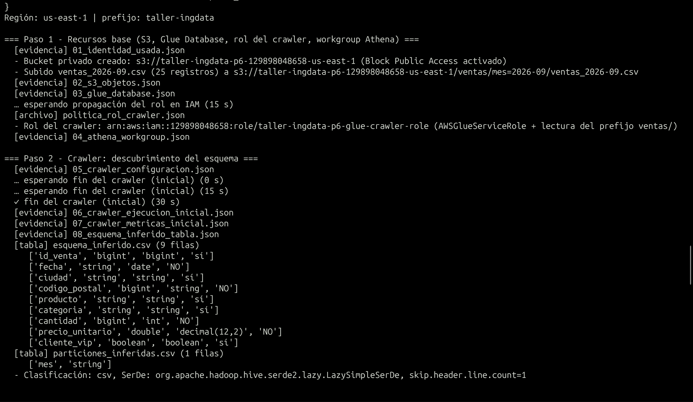
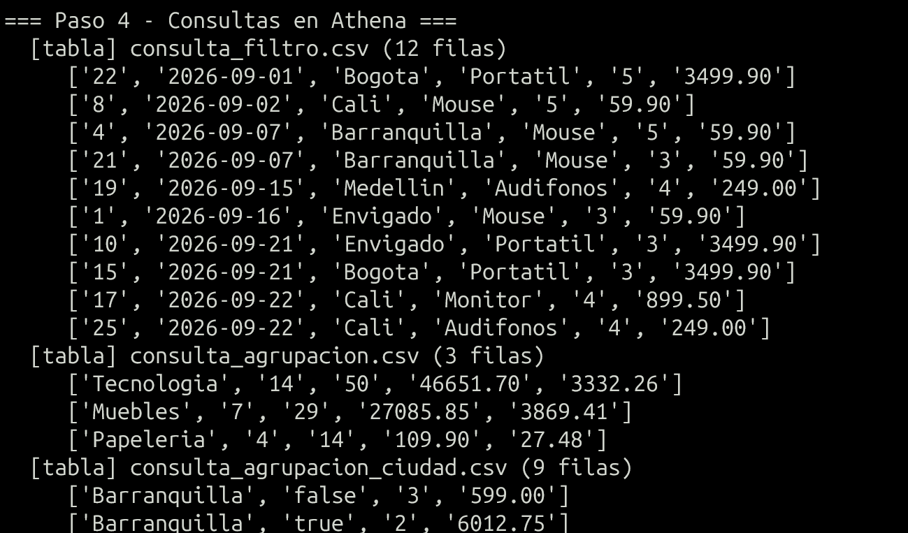
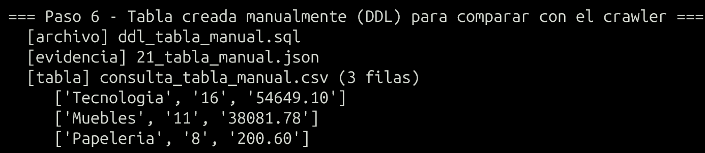
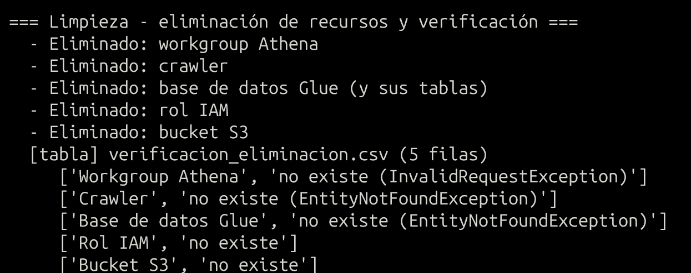

## Respuestas teóricas y de costos

### ¿Qué almacena?
**Metadatos**, no datos: bases de datos, tablas (columnas y tipos, ubicación en S3, formato y SerDe,
clasificación, claves de partición, estadísticas), particiones, conexiones, definiciones de crawlers y
clasificadores. Es un *metastore* compatible con Hive que usan Athena, EMR, Glue ETL, Redshift
Spectrum y Lake Formation.

### Archivos en S3 frente a metadatos
- **S3** guarda los **archivos reales** (los CSV con los 35 registros).
- **El catálogo** guarda la **descripción** de esos archivos: dónde están, cómo leerlos y qué columnas tienen. Athena consulta S3 usando esa descripción (*schema-on-read*). Borrar una tabla externa del catálogo **no borra** los archivos de S3, y agregar archivos a la carpeta de una tabla no particionada los hace visibles sin tocar el catálogo. Una partición nueva, en cambio, debe registrarse (crawler, `MSCK REPAIR` o `ALTER TABLE ADD PARTITION`).

### Bases de datos, tablas y crawlers
- **Base de datos**: espacio de nombres lógico que agrupa tablas (`taller_ventas_db`).
- **Tabla**: definición de metadatos que apunta a una ubicación de S3 (`ventas`, con partición `mes`).
- **Crawler**: proceso que recorre un origen (S3, JDBC…), usa **clasificadores** para detectar el formato y el esquema, y **crea o actualiza** tablas y particiones del catálogo. Se puede programar y tiene políticas de cambio de esquema (actualizar, solo registrar en el log o eliminar).

### Credenciales
S3, Glue y Athena se autorizan **solo con IAM**: el usuario usa sus credenciales de AWS CLI y el crawler
asume un **rol** (`AWSGlueServiceRole` + lectura del prefijo), por lo que recibe credenciales temporales de
STS. No hay usuario ni contraseña de aplicación, así que **no hace falta un secreto**. Solo se usaría
Secrets Manager si el crawler leyera una base de datos mediante una *Glue Connection* JDBC.

### Preguntas de costos
- **Crawler**: 0,44 USD por DPU-hora, facturado por segundo con **mínimo de 10 minutos por ejecución**. Dos ejecuciones pequeñas ≈ 0,15–0,30 USD.
- **Catálogo**: el primer millón de objetos almacenados (tablas, particiones, versiones) y el primer millón de solicitudes al mes son **gratis**; después, 1 USD por cada 100.000 objetos al mes y 1 USD por millón de solicitudes. Este taller: 0 USD.
- **S3**: 0,023 USD/GB-mes + solicitudes (PUT 0,005 USD/1.000; GET 0,0004 USD/1.000). Los CSV y los resultados de Athena ocupan KB, prácticamente 0 USD.
- **Athena**: 5 USD por TB escaneado, con **mínimo de 10 MB por consulta**; las consultas DDL (`CREATE`, `MSCK REPAIR`) y las fallidas no se cobran. Aquí cada consulta escanea KB pero se cobra como 10 MB: ≈ 0,00005 USD por consulta.
- **Efecto del volumen de datos examinados**: Athena cobra en proporción a los bytes leídos, y el crawler tarda más (más DPU-minutos) cuantos más archivos y particiones recorre. Para reducir lo que se lee: **particionar** (la consulta `WHERE mes='2026-10'` solo lee esa carpeta), usar formatos **columnares** (Parquet/ORC) y **comprimir**, seleccionar solo las columnas necesarias y fijar un límite de bytes por consulta en el workgroup (se configuró en 10 MB).

### Crawler frente a tabla manual
| | Crawler | DDL manual |
|---|---|---|
| Esquema | Inferido; puede equivocarse (códigos postales como `bigint`, fechas como `string`) | Exacto, definido por usted |
| Particiones nuevas | Las registra al volver a ejecutarse | `MSCK REPAIR TABLE`, `ALTER TABLE ADD PARTITION` o *partition projection* |
| Cambios de esquema | Los detecta (o los registra en el log con `LOG`) | Manuales |
| Costo | DPU-hora (mínimo 10 min) | Gratis (DDL de Athena) |
| Cuándo usarlo | Datos nuevos o desconocidos, muchas carpetas o formatos | Esquemas conocidos y estables |
