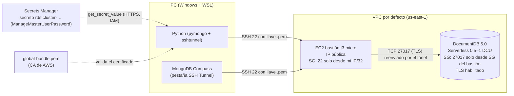

# Punto 3 – Amazon DocumentDB

## Diagrama de conexión

1. DocumentDB **no tiene endpoint público**: solo es accesible dentro de su VPC.
2. El bastión EC2 está en una subred pública de la misma VPC; su SG solo permite SSH desde la IP del estudiante.
3. El SG de DocumentDB solo permite 27017 desde el SG del bastión.
4. Túnel SSH: `localhost:27018 → bastión:22 → endpoint-docdb:27017`.
5. TLS: el clúster usa `tls=enabled`; el cliente valida con `global-bundle.pem`. Por el túnel el host es `localhost`, así que pymongo usa `tlsAllowInvalidHostnames=True` (Compass, con su túnel integrado, usa el nombre real y no lo necesita).
6. Usuario y contraseña: los genera DocumentDB en Secrets Manager; el programa los lee en tiempo de ejecución.

## Ejecución (WSL)
```bash
uv run python punto3_documentdb/documentdb.py todo                 # Serverless 0.5–1 DCU
# o con la prueba gratuita de DocumentDB (750 h de db.t3.medium):
uv run python punto3_documentdb/documentdb.py todo --provisionado
# Compass: seguir evidencias/punto3/guia_compass.md y tomar captura
uv run python punto3_documentdb/documentdb.py limpiar
```
La llave privada queda en `punto3_documentdb/.llaves/` (excluida del repositorio). Para usar `ssh` a mano desde WSL, cópiela a `~/.ssh/` y ejecute `chmod 600` (en `/mnt/c` los permisos de Linux no se aplican). En Compass (Windows) use la ruta de Windows del archivo.

## Operaciones en Python
- Base `taller`, colección `productos`, 12 documentos (con subdocumento `proveedor` y arreglo `etiquetas`).
- **Filtro**: `{"categoria": "Tecnologia", "precio": {"$gte": 300000}, "stock": {"$gt": 0}}`
- **Ordenación**: `sort(precio desc, nombre asc).limit(5)`
- **Agregación**: `$match` → `$group` por categoría (conteo, precio promedio, unidades, valor del inventario) → `$sort`; además `$unwind` de etiquetas.
