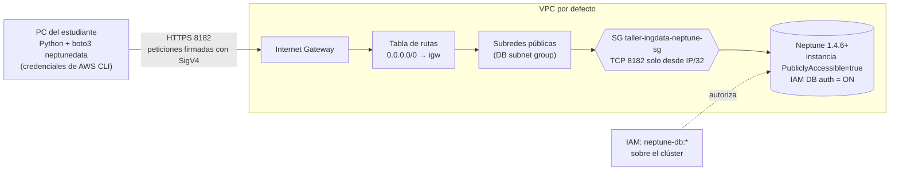

# Punto 4 – Amazon Neptune

## Elección de capacidad
| Opción | Precio de referencia us-east-1 | Para este taller |
|---|---|---|
| Aprovisionada `db.t4g.medium` (o `db.t3.medium`) | ≈ 0,08–0,10 USD/h (el script la consulta en la Price List API) | **Elegida**: la más barata; la capa gratuita de Neptune cubre 750 h de t3/t4g.medium durante 30 días |
| Serverless | 0,1608 USD por NCU-hora, mínimo 1 NCU | Incluso al mínimo cuesta más por hora que una t4g.medium y no baja a 0 |

## Acceso desde el computador local: endpoint público (sin EC2)

- **VPC/rutas**: VPC por defecto; sus subredes son públicas (ruta `0.0.0.0/0 → Internet Gateway`). El script guarda las tablas de rutas en `vpc_rutas.json`.
- **Grupo de seguridad**: solo TCP 8182 desde la IP pública actual (`/32`).
- **Autenticación**: obligatoriamente IAM (SigV4). No hay usuario ni contraseña de BD, así que no se necesita un secreto. Para la firma se usan las credenciales del perfil de AWS CLI. Permiso necesario: `neptune-db:*` (o `connect`, `ReadDataViaQuery`, `WriteDataViaQuery`, `DeleteDataViaQuery`) sobre `arn:aws:neptune-db:<region>:<cuenta>:<cluster-resource-id>/*`.

### ¿Es necesario el túnel con EC2? ¿Hay otras maneras?
No, desde la versión 1.4.6 (septiembre de 2025). Las alternativas son:
1. **Túnel SSH con un bastión EC2** en una subred pública: `ssh -i llave.pem -N -L 8182:<endpoint-neptune>:8182 ec2-user@<ip-ec2>`. Añade el costo de la EC2 (≈ 0,0104 USD/h en t3.micro + IPv4 pública 0,005 USD/h) y la gestión de llaves y del puerto 22. Con IAM auth, el encabezado `Host` firmado no coincide con `localhost`, así que hay que firmar con el endpoint real o desactivar la verificación TLS.
2. **SSM Session Manager port forwarding** (`AWS-StartPortForwardingSessionToRemoteHost`): también necesita una EC2, pero sin abrir el puerto 22 ni manejar llaves.
3. **Neptune Workbench / Graph Notebook** (SageMaker) dentro de la VPC.
4. **Client VPN / Site-to-Site VPN** o **Lambda/API Gateway** dentro de la VPC.

## Modelo del grafo (`grafo.json`)
14 vértices (6 `Estudiante`, 2 `Profesor`, 4 `Curso`, 2 `Ciudad`) y 33 relaciones (`CONOCE`, `INSCRITO_EN{nota}`, `DICTA`, `REQUIERE`, `VIVE_EN`). El script genera `evidencias/punto4/modelo_grafo.md` con el diagrama.

## Consultas (`consultas.cypher`, `consultas.gremlin`)
| Consulta | Recorrido |
|---|---|
| q1 recomendar amigos | Estudiante –CONOCE– amigo –CONOCE– sugerido (2 saltos, excluye a los ya conocidos) |
| q2 profesores de Medellín | Ciudad ←VIVE_EN– Estudiante –INSCRITO_EN→ Curso ←DICTA– Profesor (3 saltos) |
| q3 prerrequisitos | Curso –REQUIERE*1..5→ Curso (longitud variable) |
| q4 cadena de contactos | Ana –CONOCE*1..4– Felipe (caminos) |
| g1–g3 | Equivalentes en Gremlin |

## Ejecución
```bash
uv run python punto4_neptune/neptune_grafo.py todo      # ~15 min (creación del clúster)
uv run python punto4_neptune/neptune_grafo.py limpiar
```
Si su IP cambia, vuelva a autorizarla en el grupo de seguridad (o borre y ejecute `crear`).
